# L'interfaccia di RaceBuddy

Le schermate principali dell'app a larghezza telefono (390 px), tema chiaro.
Dati di esempio: Luca, Roma, uscita alle 7:00; obiettivo Firenze Marathon (29/11), tappa Rome Half Marathon (18/10);
meteo simulato. Le foto degli articoli non sono caricate e i campi di ora e data hanno il formato del browser di prova
(su un telefono italiano: 07:00 e gg/mm/aaaa). Le schermate sono state prese il 15 ottobre 2026.

Come è fatta dietro: [architettura.md](architettura.md).

## Struttura

Una colonna da telefono (massimo 480 px) con la barra fissa in basso: **Oggi · Gare · Per te · Gruppo · Io**.
Navigazione a hash (`#/oggi`, `#/gara/:id/borsa`, …). Caratteri Barlow e Barlow Condensed; arancio per le azioni e
blu notte per i riquadri in evidenza; tema chiaro e scuro automatici.

## Benvenuto

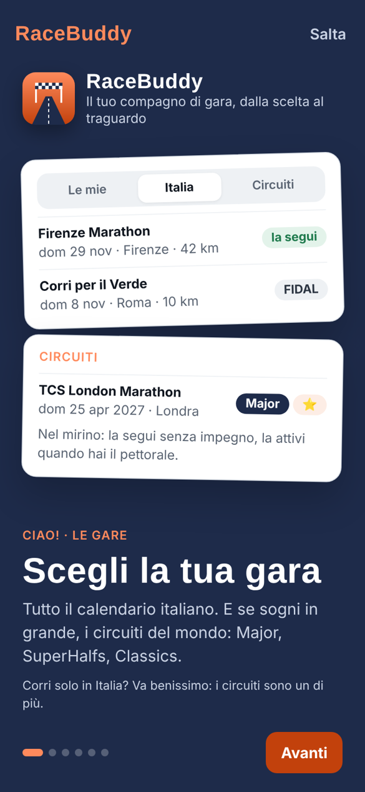

Al primo avvio, rivedibile da Io: cinque schermate dimostrative (La preparazione, Meteo e avvisi, La gara, Il gruppo,
Partiamo). Si scorrono con il dito o con "Avanti"; "Salta" porta all'app.

## Prepara RaceBuddy

| Scheda in Oggi | Tessera e certificato | Traguardo: notifiche |
|---|---|---|
| 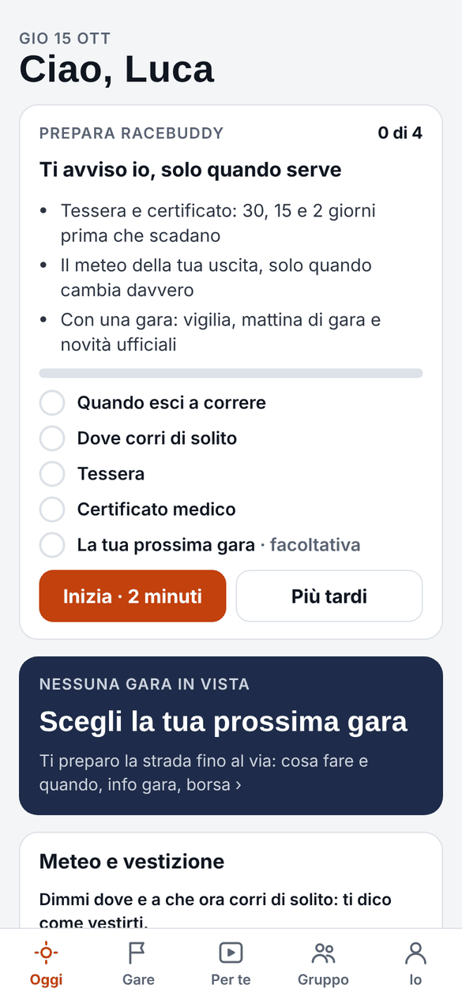 | 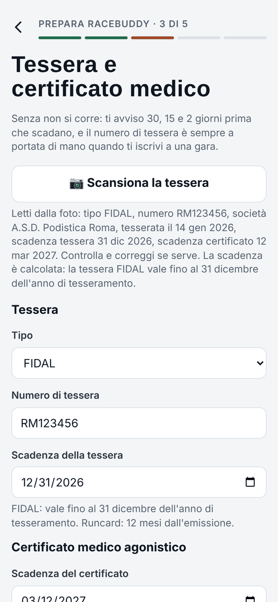 | 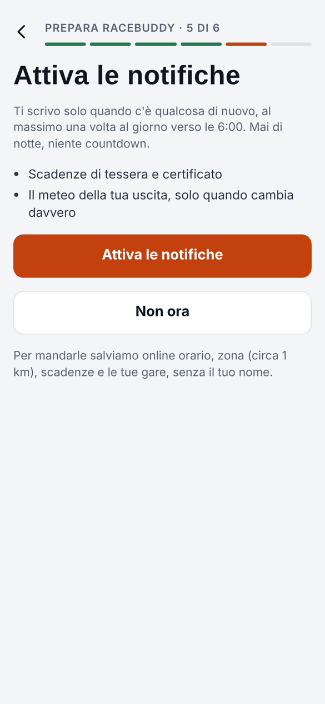 |

In cima a Oggi, finché manca qualcosa: spiega cosa ti arriva con le notifiche e conta i passi (**x di 3**).
"Inizia" apre il funnel `#/prepara`, un passo per schermata senza barra in basso:

1. A che ora esci a correre (decide l'ora del messaggio del mattino)
2. Dove corri di solito (GPS o città: serve per il meteo dell'uscita)
3. Tessera e certificato medico, in un solo passo: tipo, numero, scadenza, codice e nome società della tessera;
   scadenza del certificato
4. Notifiche: il traguardo, con i vantaggi concreti (su iPhone fuori dalla Home, le istruzioni per aggiungerla)
5. La tua prossima gara: facoltativa

"Scansiona la tessera o carica il PDF" legge i dati sul telefono: dal PDF del tesserino FIDAL il testo è esatto, da
una foto passa dall'OCR. Il tesserino FIDAL riporta l'anno di validità (la tessera vale fino al 31 dicembre), il
numero, la squadra e la scadenza del certificato medico: una sola scansione compila tutto, da controllare prima di andare avanti. Chi ha il certificato separato può scansionare anche
quello. La stessa scansione c'è in Io → Tessera e certificato.

I passi già fatti si saltano. "Più tardi" nasconde la scheda per 3 giorni. Con i tre passi fatti e le notifiche
spente resta una scheda più piccola: "ultimo passo, attiva le notifiche". Foto e altri dettagli dei documenti restano in Io. Per ora l'app è per chi fa gare: tessera e certificato sono
obbligatori.

## Oggi

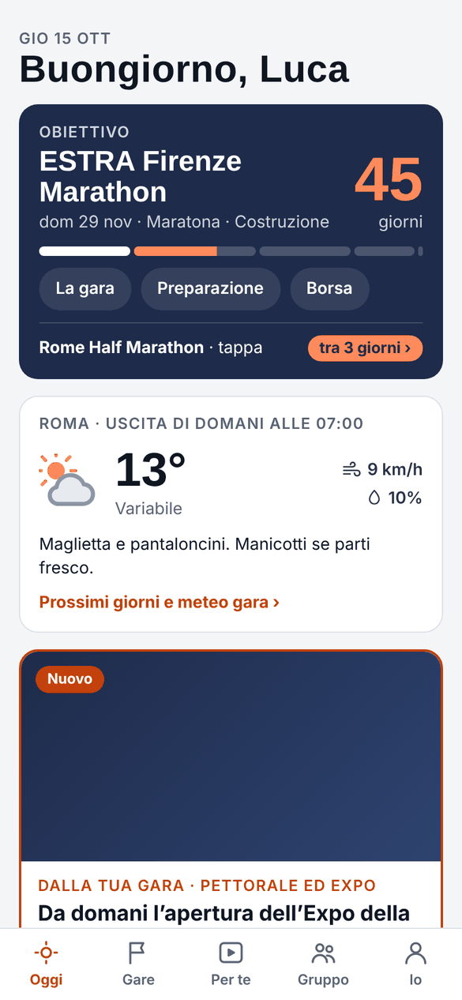

- gara in evidenza: giorni mancanti, fase della preparazione, link a La gara, Preparazione e Borsa; le altre gare sotto
- meteo dell'uscita di domani con la vestizione
- "Dalla tua gara": la novità ufficiale più recente, finché non è vista
- poi avvisi dei documenti, momenti, cose da fare oggi, pillola e contenuti Per te

## Gare

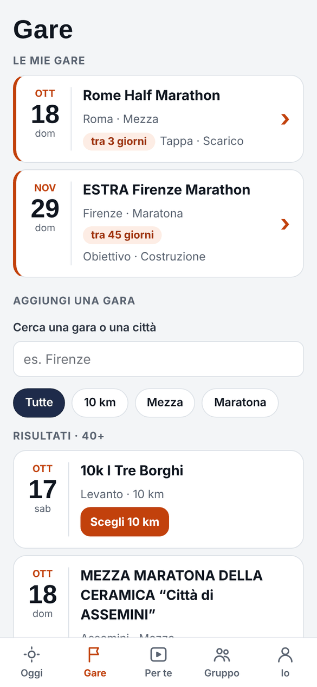

Le mie gare (data, distanza, ruolo, fase, giorni mancanti) e la ricerca nel calendario FIDAL per aggiungerne una,
con filtri per distanza.

## La gara

Quattro sezioni nella barra a segmenti in alto, anche con lo swipe orizzontale: **Panoramica · Preparazione · Info gara · Borsa**.
La freccia indietro porta alla Panoramica.

| Panoramica | Preparazione |
|---|---|
| 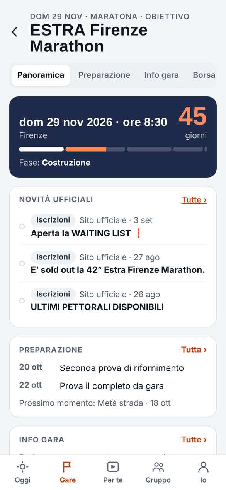 | 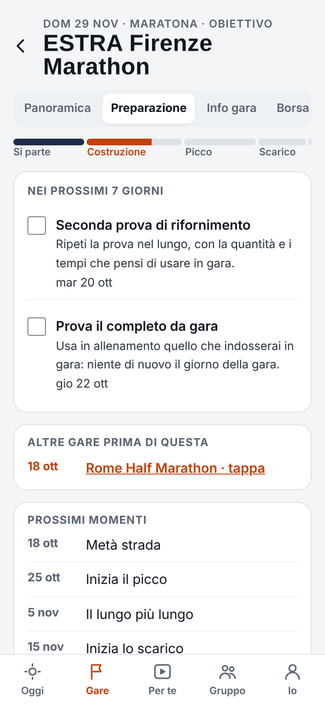 |
| Quanto manca, fase, novità ufficiali della gara, prossime cose della preparazione, info chiave, borsa, gruppo. Ogni riquadro rimanda alla sua sezione. | Il percorso di avvicinamento: fasi, cose dei prossimi 7 giorni da spuntare, altre gare prima di questa, prossimi momenti, tutta la preparazione fase per fase. |

| Info gara | Borsa |
|---|---|
| 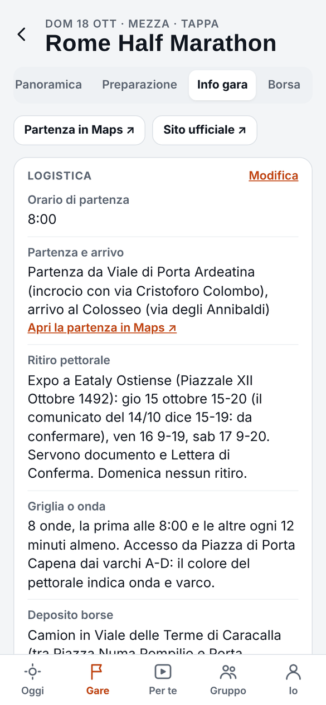 | 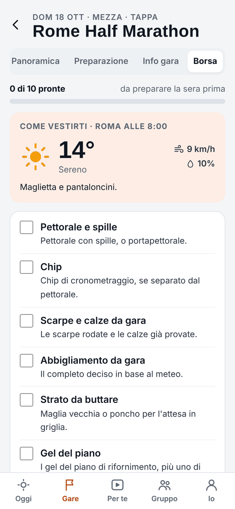 |
| Logistica dal sito ufficiale (partenza, ritiro pettorale, griglia, deposito, ristori, come arrivare), percorso di gara, meteo, fonti. Modificabile a mano. | Contatore "pronte", vestizione con il meteo della gara, checklist da spuntare, voci personali. In fondo la mattina della gara come lista numerata da leggere, senza caselle. |

## Per te

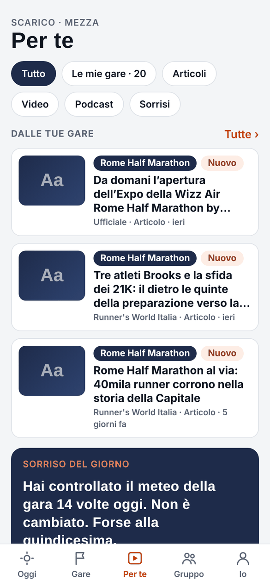

In cima "Dalle tue gare": novità ufficiali e articoli sulle gare seguite, con il filtro "Le mie gare". Sotto articoli,
video e podcast scelti per fase e distanza, e i sorrisi.

## Gruppo

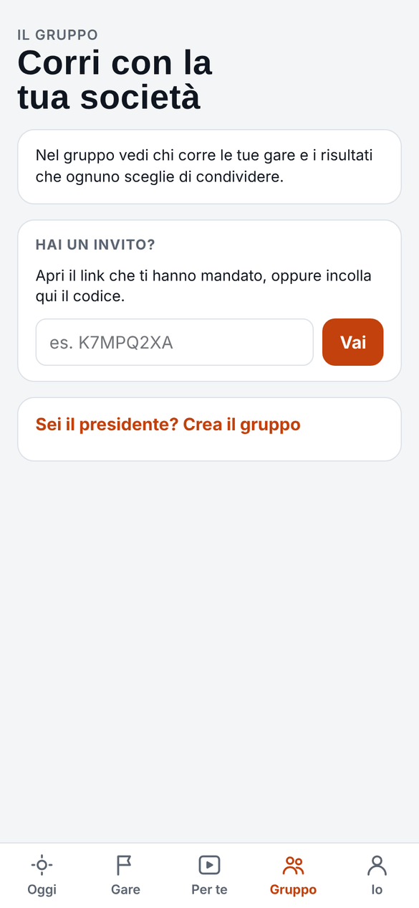

Senza gruppo: entrare con il codice d'invito o crearne uno. Dentro: gare in comune, bacheca con applausi, classifica
dei personali (solo per chi sceglie di comparire), gestione per admin e organizzatori.

## Io

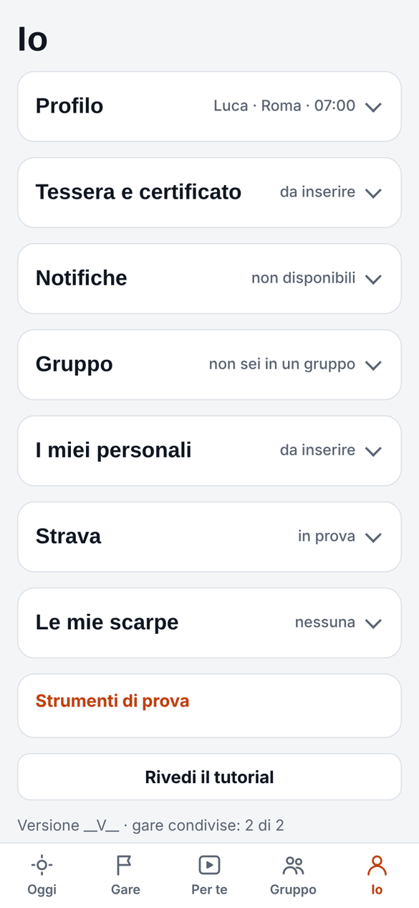

Sezioni a fisarmonica: Profilo, Tessera e certificato (gli stessi campi del funnel, più "Scarica" del PDF o della
foto da caricare nei portali di iscrizione), Notifiche con preferenze, Gruppo, I miei personali, Strava,
Le mie scarpe. In fondo gli strumenti di prova (data simulata) e "Rivedi il tutorial".

## Aggiornare le schermate

Le schermate si rifanno con Playwright, servendo localmente `app/`, `content/` e `data/` (come fa "Pubblica web app")
e caricando lo stato di esempio in `localStorage` (`racebuddy.v1`). Chiedilo a Claude: "aggiorna le schermate di docs/ui.md".
